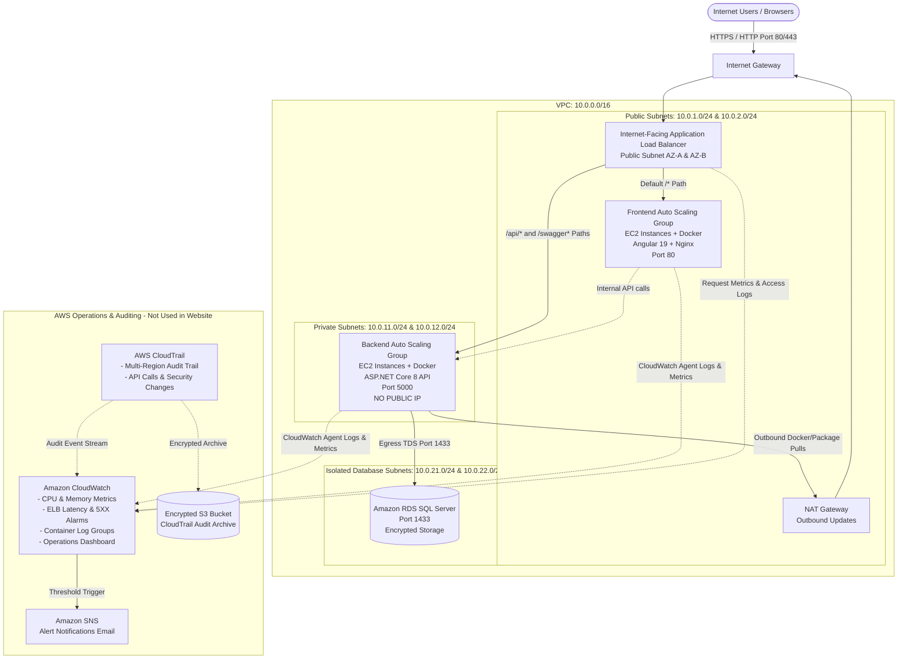

# TrustVault AWS Production Hosting Architecture & Deployment Guide

This document provides the complete architecture and deployment instructions to host the **TrustVault** application on AWS in accordance with enterprise security and high-availability standards:
- **Frontend** in **Public Subnets** behind an **Application Load Balancer (ALB / ELB)**
- **Backend API** in **Private Subnets** (no public IP, completely unreachable directly from the internet)
- **Database** in **Isolated Private Database Subnets**
- **Docker** containerization for cross-platform portability and dependency isolation
- **EC2 Auto Scaling Groups (ASG)** to dynamically scale both tiers when user requests surge
- **Amazon CloudWatch** for infrastructure metrics, alarms, and container logs (AWS-internal only)
- **AWS CloudTrail** for multi-region security and governance auditing (AWS-internal only, never exposed inside the website)

---

## 1. High-Level Architecture Diagram



---

## 2. Infrastructure Breakdown

### 2.1 Network Topology (VPC)
- **VPC CIDR**: `10.0.0.0/16` across 2 Availability Zones (`us-east-1a`, `us-east-1b`).
- **2 Public Subnets** (`10.0.1.0/24`, `10.0.2.0/24`):
  - Attached to an Internet Gateway (`IGW`).
  - Contains the public Application Load Balancer and Frontend Auto Scaling instances.
  - Contains an Elastic IP (`EIP`) and NAT Gateway.
- **2 Private Application Subnets** (`10.0.11.0/24`, `10.0.12.0/24`):
  - Routed through the NAT Gateway for outbound traffic only (OS security updates, pulling Docker images).
  - No public IP addresses assigned (`map_public_ip_on_launch = false`).
  - Hosts the Backend API Auto Scaling instances.
- **2 Private Database Subnets** (`10.0.21.0/24`, `10.0.22.0/24`):
  - Isolated subnets with no internet gateway route.
  - Hosts the RDS SQL Server database instance.

### 2.2 Security Group Rules (Strict Layering)
| Security Group | Inbound Allowed | Outbound Allowed | Purpose |
| :--- | :--- | :--- | :--- |
| `sg-alb` | Ports 80 & 443 from `0.0.0.0/0` | Port 80 to `sg-frontend`, Port 5000 to `sg-backend` | Public ingress |
| `sg-frontend` | Port 80 strictly from `sg-alb` | Port 5000 to `sg-backend`, Port 443 outbound | Frontend instances |
| `sg-backend` | Port 5000 strictly from `sg-alb` and `sg-frontend` | Port 1433 to `sg-db`, Port 443 outbound via NAT | Backend API instances (Private) |
| `sg-database` | Port 1433 strictly from `sg-backend` | None | SQL Server Database |

### 2.3 Elastic Load Balancer (ELB / ALB) & Path Routing
The Application Load Balancer operates as the single secure entry point:
- **Port 80/443 Listener**:
  - `Path = /api/*` ➔ Forwards directly to `trustvault-tg-backend` (Private Subnet instances on port 5000).
  - `Path = /swagger*` ➔ Forwards to `trustvault-tg-backend`.
  - `Default Rule (/*)` ➔ Forwards to `trustvault-tg-frontend` (Public Subnet instances on port 80).
- **Health Checks**:
  - Frontend: `GET /health` (Returns HTTP 200 via Nginx).
  - Backend: `GET /health` (Returns HTTP 200 via ASP.NET Core minimal API).

### 2.4 Auto Scaling Groups (Handling High Traffic)
- **Frontend ASG**:
  - Sizing: Min 2, Desired 2, Max 6 instances.
  - Target Tracking Scaling Policy 1: Average CPU Utilization > 60%.
  - Target Tracking Scaling Policy 2: ALB Request Count per Target > 1,000 requests/minute.
- **Backend ASG**:
  - Sizing: Min 2, Desired 2, Max 8 instances.
  - Target Tracking Scaling Policy 1: Average CPU Utilization > 70%.
  - Target Tracking Scaling Policy 2: ALB Request Count per Target > 800 requests/minute.

### 2.5 CloudWatch & CloudTrail (AWS-Internal Only)
As specified in requirements, these logs are exclusively used for AWS operational management and security auditing, never rendered or exposed within the website:
- **Amazon CloudWatch Agent**:
  - Installed on all EC2 instances via User Data script.
  - Streams host `/var/log/messages` and Docker container stdout/stderr to `/aws/ec2/trustvault-frontend` and `/aws/ec2/trustvault-backend`.
  - Collects hardware metrics (`mem_used_percent`, `disk_used_percent`, CPU).
- **Alarms & SNS**:
  - Alarms on High CPU (>85%), Unhealthy Backend Hosts, and ALB 5XX error spikes.
  - Pushes alerts to the `trustvault-ops-alerts` SNS Topic.
- **AWS CloudTrail**:
  - Multi-region trail capturing all AWS management events, IAM logins, and infrastructure changes.
  - Encrypted write-protected S3 bucket (`trustvault-cloudtrail-audit-<account-id>`) with log file validation.
  - Continuous streaming to CloudWatch Log Group `/aws/cloudtrail/trustvault-audit-trail`.

---

## 3. Directory Structure

The repository includes ready-to-run configurations for this architecture:

```
snovasys-project/
├── aws-infrastructure/
│   ├── main.tf                    # Terraform AWS Provider & setup
│   ├── variables.tf               # Configurable parameters (region, ASG sizing, secrets)
│   ├── outputs.tf                 # ALB DNS, VPC ID, Subnet IDs, CloudWatch URLs
│   ├── vpc.tf                     # VPC, 6 Subnets (2 Public, 2 Private App, 2 Private DB), IGW, NAT GW
│   ├── security_groups.tf         # Layered Security Groups
│   ├── alb.tf                     # Application Load Balancer & path-based routing
│   ├── iam.tf                     # IAM Roles for EC2 (CloudWatch Agent, SSM, ECR)
│   ├── asg_frontend.tf            # Frontend Launch Template & ASG in Public Subnets
│   ├── asg_backend.tf             # Backend Launch Template & ASG in Private Subnets
│   ├── rds.tf                     # RDS SQL Server in Private Database Subnets
│   ├── cloudwatch.tf              # CloudWatch Log Groups, Alarms & Operations Dashboard
│   ├── cloudtrail.tf              # AWS CloudTrail & Encrypted S3 Bucket
│   ├── user_data_frontend.sh      # EC2 bootstrap script for Docker + Frontend
│   ├── user_data_backend.sh       # EC2 bootstrap script for Docker + Backend
│   └── terraform.tfvars.example   # Sample variables configuration
├── frontend/
│   ├── Dockerfile                 # Multi-stage Docker build for Angular 19
│   ├── nginx.conf                 # Production Nginx reverse proxy & SPA routing
│   └── src/environments/
│       ├── environment.ts         # Development environment
│       └── environment.prod.ts    # Production environment (relative /api/v1)
├── backend/
│   ├── Dockerfile                 # Multi-stage Docker build for .NET 8 API
│   └── TrustVault.Api/
│       └── Program.cs             # Includes /health endpoint for ELB health checks
├── docker-compose.prod.yml        # Production Docker compose for testing
└── docs/
    └── AWS_HOSTING_ARCHITECTURE_GUIDE.md
```

---

## 4. Step-by-Step Deployment Instructions

### Step 1: Build & Push Docker Images to AWS ECR

1. Authenticate Docker with your AWS Elastic Container Registry (ECR):
   ```bash
   aws ecr get-login-password --region us-east-1 | docker login --username AWS --password-stdin <YOUR_AWS_ACCOUNT_ID>.dkr.ecr.us-east-1.amazonaws.com
   ```

2. Create ECR repositories (if not already created):
   ```bash
   aws ecr create-repository --repository-name trustvault-frontend --region us-east-1
   aws ecr create-repository --repository-name trustvault-backend --region us-east-1
   ```

3. Build and tag the frontend container image:
   ```bash
   cd frontend
   docker build -t trustvault-frontend:latest .
   docker tag trustvault-frontend:latest <YOUR_AWS_ACCOUNT_ID>.dkr.ecr.us-east-1.amazonaws.com/trustvault-frontend:latest
   docker push <YOUR_AWS_ACCOUNT_ID>.dkr.ecr.us-east-1.amazonaws.com/trustvault-frontend:latest
   cd ..
   ```

4. Build and tag the backend container image:
   ```bash
   cd backend
   docker build -t trustvault-backend:latest -f Dockerfile .
   docker tag trustvault-backend:latest <YOUR_AWS_ACCOUNT_ID>.dkr.ecr.us-east-1.amazonaws.com/trustvault-backend:latest
   docker push <YOUR_AWS_ACCOUNT_ID>.dkr.ecr.us-east-1.amazonaws.com/trustvault-backend:latest
   cd ..
   ```

---

### Step 2: Provision Infrastructure with Terraform

1. Navigate to the `aws-infrastructure` folder:
   ```bash
   cd aws-infrastructure
   ```

2. Copy the example configuration and set your parameters:
   ```bash
   cp terraform.tfvars.example terraform.tfvars
   ```
   *Edit `terraform.tfvars` with your email for alarms and strong passwords/secrets.*

3. In `asg_frontend.tf` and `asg_backend.tf`, replace the default image placeholders with your ECR image URIs:
   - `FRONTEND_IMAGE_URI = "<YOUR_AWS_ACCOUNT_ID>.dkr.ecr.us-east-1.amazonaws.com/trustvault-frontend:latest"`
   - `BACKEND_IMAGE_URI = "<YOUR_AWS_ACCOUNT_ID>.dkr.ecr.us-east-1.amazonaws.com/trustvault-backend:latest"`

4. Initialize and apply Terraform:
   ```bash
   terraform init
   terraform plan -out=tfplan
   terraform apply tfplan
   ```

5. Terraform will output:
   - `application_url`: The public ALB URL (e.g., `http://trustvault-alb-prod-123456789.us-east-1.elb.amazonaws.com`).
   - `cloudwatch_dashboard`: `trustvault-operations-production`.
   - `cloudtrail_audit_s3_bucket`: S3 bucket name holding the audit logs.

---

### Step 3: Verification & Security Validation

1. **Verify Web Application**:
   Open the `application_url` in your browser. The Angular frontend loads over port 80.
   Navigate to `/swagger` or perform an API call; the ALB automatically routes `/api/*` to the private backend instances.

2. **Verify Subnet Isolation (Private Backend)**:
   - Go to AWS EC2 Console ➔ Instances.
   - Select a Backend instance (`trustvault-backend-instance-production`).
   - Notice that **Public IPv4 address is empty** (None).
   - Use AWS Systems Manager (SSM) Session Manager to connect to the instance without opening SSH or exposing port 22:
     ```bash
     aws ssm start-session --target <BACKEND_INSTANCE_ID>
     ```
   - From inside the backend instance, run:
     ```bash
     docker ps
     ```
     You will observe the `trustvault-backend` container running on port 5000.

3. **Verify Load Balancer & Auto Scaling**:
   - Check the Target Groups in the EC2 Console:
     - `trustvault-tg-frontend`: Health status is **Healthy** (`/health` returns 200).
     - `trustvault-tg-backend`: Health status is **Healthy** (`/health` returns 200).
   - Simulate load test or high CPU: The Auto Scaling Groups automatically launch additional EC2 instances and register them into the ALB.

4. **Verify CloudWatch & CloudTrail Logs**:
   - Open **AWS CloudWatch Console** ➔ **Dashboards** ➔ Click `trustvault-operations-production` to view live traffic graphs, CPU, and healthy host counts.
   - Open **Log Groups**:
     - `/aws/ec2/trustvault-frontend` displays frontend container and Nginx logs.
     - `/aws/ec2/trustvault-backend` displays ASP.NET Core API logs.
     - `/aws/cloudtrail/trustvault-audit-trail` displays real-time AWS API actions and security modifications.
   - Open **AWS CloudTrail Console**: Audit trail `trustvault-aws-audit-trail` records all administrative activities into the private S3 bucket.
